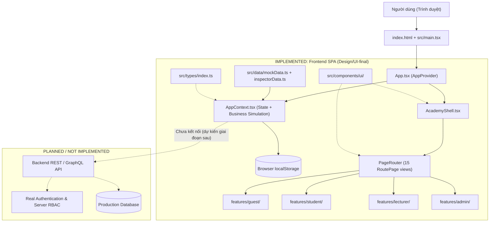

# Kiến trúc Hệ thống (Architecture)

Tài liệu này mô tả **kiến trúc thực tế** đang tồn tại trong repository **NetWiz** sau khi khảo sát toàn bộ mã nguồn, đồng thời phân tách rõ những thành phần mới ở trạng thái `PLANNED / NOT IMPLEMENTED`.

---

## 1. Tổng quan thực tế (`CONFIRMED`)

Hiện tại repository **chưa có ứng dụng Production** ở thư mục gốc (`index.html`, `js/main.js`, `style/Style.css` đều 0 byte; `Pages/` trống). Toàn bộ mã nguồn đang chạy là **ứng dụng Frontend SPA `Design/UI-final/`** (được chốt chính thức từ Demo V3, kèm gói CSS tách riêng tại [`Design/Style/`](../../Design/Style/README.md)):

- [`Design/UI-final/`](../../Design/UI-final) — Giao diện chính thức đã chốt (`Cyber Academy · UI Final`)

*(Các bản thử nghiệm trước đó `demo-v1` và `demo-v2` đã được xóa khỏi `Design/` sau khi chốt style chính thức; lịch sử vẫn lưu trong Git ở commit `42a390c` và `f6f8a2b`.)*

---

## 2. Chi tiết từng lớp kiến trúc

| Thành phần | Trạng thái | Mô tả thực tế đã xác minh |
|---|---|---|
| **Frontend** | `IMPLEMENTED` (`Design/UI-final`) | React 18 + TypeScript + Vite + Tailwind CSS v4. Toàn bộ ứng dụng SPA nằm trong `Design/UI-final/src/`. |
| **Backend** | `NOT IMPLEMENTED` / `PLANNED` | Không có thư mục server, controller, middleware hay runtime backend nào trong repository. |
| **API** | `NOT IMPLEMENTED` / `PLANNED` | Không có REST API, GraphQL hay WebSocket. Mọi thao tác CRUD đều chạy đồng bộ trên state phía trình duyệt. |
| **Database** | `NOT IMPLEMENTED` / `PLANNED` | Không có database thực tế. Dữ liệu khởi tạo từ `src/data/mockData.ts` và lưu tạm vào `localStorage` của trình duyệt. |
| **Authentication** | `IMPLEMENTED` (Mô phỏng) / `PLANNED` (Thực tế) | `LoginModal` và `AppContext.tsx` cho phép chuyển đổi tức thì giữa Guest, Student, 3 tài khoản Lecturer và Admin không cần mật khẩu/token thật. |
| **State Management** | `IMPLEMENTED` | React Context API (`AppProvider` / `useApp()` trong `src/store/AppContext.tsx`) quản lý toàn bộ `PersistedDemoState`, UI state, `theme`, `calmMode` và `ToastItem[]`, tự động đồng bộ `localStorage`. |
| **Routing** | `IMPLEMENTED` | Điều hướng nội bộ bằng React state `page: RoutePage` (15 route) trong `AppContext.tsx`, kết hợp lắng nghe `window.location.hash` riêng cho đường dẫn chia sẻ ghi chú `#/shared-note/:noteId`. Không dùng React Router. |
| **Component Structure** | `IMPLEMENTED` | `main.tsx` -> `App.tsx` (`AppProvider` -> `AcademyShell` -> `PageRouter` + `LoginModal` + `ToastContainer`). UI nguyên thủy ở `src/components/ui/`, màn hình nghiệp vụ ở `src/features/{guest,student,lecturer,admin}/`. |
| **External Services** | `CONFIRMED` (Tối thiểu) | Chỉ tải Google Fonts CDN qua `<link>` trong `index.html`. Không gọi API bên thứ ba nào khác. |
| **Module Dependencies** | `CONFIRMED` | Dữ liệu tách riêng khỏi UI trong `src/types/index.ts`, `src/data/mockData.ts` và `src/data/inspectorData.ts`. Bộ CSS token chuẩn cũng được xuất sang `Design/Style/`. |

---

## 3. Sơ đồ Kiến trúc Hiện tại & Phạm vi Chưa Triển khai

---

## 4. Khóa `localStorage` của `Design/UI-final` (`CONFIRMED`)

| Key | Mục đích | Giá trị |
|---|---|---|
| `netwiz_superhero_demo_v3_state` | Lưu `PersistedDemoState` (tiến độ, ghi chú, lớp học, kiểm duyệt) | JSON |
| `netwiz_v3_theme` | Lưu lựa chọn giao diện Sáng / Tối | `'dark'` \| `'light'` |
| `netwiz_v3_calm_mode` | Lưu trạng thái chế độ Dịu mắt | `'true'` \| `'false'` |

*(Giữ nguyên tên key từ V3 để bảo toàn trạng thái trình duyệt sau khi đổi tên thư mục sang `UI-final`.)*
