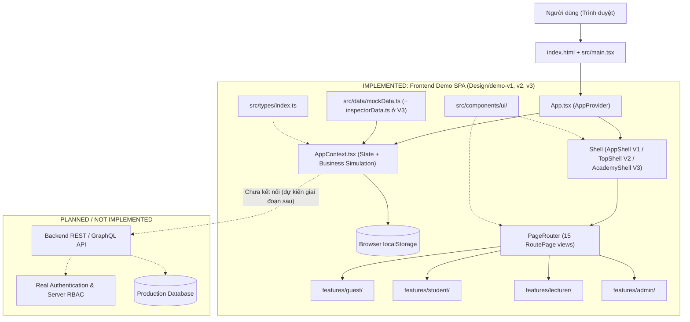

# Kiến trúc Hệ thống (Architecture)

Tài liệu này mô tả **kiến trúc thực tế** đang tồn tại trong repository **NetWiz** sau khi khảo sát toàn bộ mã nguồn, đồng thời phân tách rõ những thành phần mới ở trạng thái `PLANNED / NOT IMPLEMENTED`.

---

## 1. Tổng quan thực tế (`CONFIRMED`)

Hiện tại repository **chưa có ứng dụng Production** ở thư mục gốc (`index.html`, `js/main.js`, `style/Style.css` đều 0 byte; `Pages/` trống). Toàn bộ mã nguồn đang chạy là **3 ứng dụng Frontend SPA độc lập** nằm trong `Design/`:

- [`Design/demo-v1/`](../../Design/demo-v1) — UI/UX Demo V1 (`Dark Command Cobalt`)
- [`Design/demo-v2/`](../../Design/demo-v2) — UI/UX Demo V2 (`Focus Studio`)
- [`Design/demo-v3/`](../../Design/demo-v3) — UI/UX Demo V3 (`Cyber Academy`)

Cả 3 bản Demo dùng chung mô hình kiến trúc Frontend giống nhau nhưng **không chia sẻ package hoặc thư mục code chung** tại runtime.

---

## 2. Chi tiết từng lớp kiến trúc

| Thành phần | Trạng thái | Mô tả thực tế đã xác minh |
|---|---|---|
| **Frontend** | `IMPLEMENTED` (Demo V1–V3) | React 18 + TypeScript + Vite + Tailwind CSS v4. Mỗi bản demo là một SPA tự chứa trong `Design/demo-v*/src/`. |
| **Backend** | `NOT IMPLEMENTED` / `PLANNED` | Không có thư mục server, controller, middleware hay runtime backend nào trong repository. |
| **API** | `NOT IMPLEMENTED` / `PLANNED` | Không có REST API, GraphQL hay WebSocket. Mọi thao tác CRUD đều chạy đồng bộ trên state phía trình duyệt. |
| **Database** | `NOT IMPLEMENTED` / `PLANNED` | Không có database thực tế. Dữ liệu khởi tạo từ `src/data/mockData.ts` và lưu tạm vào `localStorage` của trình duyệt. |
| **Authentication** | `IMPLEMENTED` (Mô phỏng) / `PLANNED` (Thực tế) | `LoginModal` và `AppContext.tsx` cho phép chuyển đổi tức thì giữa Guest, Student, 3 tài khoản Lecturer và Admin không cần mật khẩu/token thật. |
| **State Management** | `IMPLEMENTED` | React Context API (`AppProvider` / `useApp()` trong `src/store/AppContext.tsx`) quản lý toàn bộ `PersistedDemoState`, UI state và `ToastItem[]`, tự động đồng bộ `localStorage`. |
| **Routing** | `IMPLEMENTED` | Điều hướng nội bộ bằng React state `page: RoutePage` (15 route) trong `AppContext.tsx`, kết hợp lắng nghe `window.location.hash` riêng cho đường dẫn chia sẻ ghi chú `#/shared-note/:noteId`. Không dùng React Router. |
| **Component Structure** | `IMPLEMENTED` | `main.tsx` -> `App.tsx` (`AppProvider` -> Shell -> `PageRouter` + `LoginModal` + `ToastContainer`). UI nguyên thủy ở `src/components/ui/`, màn hình nghiệp vụ ở `src/features/{guest,student,lecturer,admin}/`. |
| **External Services** | `CONFIRMED` (Tối thiểu) | Chỉ tải Google Fonts CDN qua `<link>` trong `index.html` của mỗi bản demo. Không gọi API bên thứ ba nào khác. |
| **Module Dependencies** | `CONFIRMED` | `src/types/index.ts` và `src/data/mockData.ts` giống hệt nhau giữa V1, V2, V3 (cùng SHA256). V3 có thêm `src/data/inspectorData.ts` và `NetworkInspector.tsx`. Không có phụ thuộc chéo giữa 3 thư mục demo. |

---

## 3. Sơ đồ Kiến trúc Hiện tại & Phạm vi Chưa Triển khai

---

## 4. Khóa `localStorage` theo từng phiên bản Demo (`CONFIRMED`)

| Phiên bản | Key dữ liệu nghiệp vụ (`PersistedDemoState`) | Key tùy chọn giao diện |
|---|---|---|
| **Demo V1** | `netwiz_superhero_demo_v1_state` | *(Không có)* |
| **Demo V2** | `netwiz_superhero_demo_v2_state` | `netwiz_v2_theme` (`'light'` \| `'dark'`) |
| **Demo V3** | `netwiz_superhero_demo_v3_state` | `netwiz_v3_theme` (`'dark'` \| `'light'`), `netwiz_v3_calm_mode` (`'true'` \| `'false'`) |

Các key tách biệt giúp chạy đồng thời V1 (`:5173`), V2 (`:5174`), V3 (`:5175`) trên `localhost` mà không ghi đè trạng thái dữ liệu của nhau.
