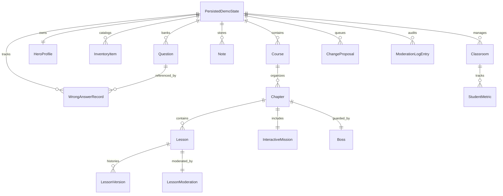

# Mô hình Dữ liệu (Data Model)

Tài liệu này phân tách rõ **Existing Data Model** (đã xác minh trực tiếp từ `src/types/index.ts` và `src/data/mockData.ts`, đồng nhất giữa `demo-v1`, `demo-v2`, `demo-v3`) và **Proposed Data Model** (định hướng cho Backend/Database tương lai, `PLANNED / NOT IMPLEMENTED`).

---

## Phần A: Existing Data Model (`CONFIRMED` / `IMPLEMENTED` Frontend)

> Nguồn xác minh chính: `Design/demo-v3/src/types/index.ts` (SHA256 khớp hoàn toàn với `demo-v1` và `demo-v2`).

### 1. Sơ đồ quan hệ thực thể hiện có (Frontend State)

### 2. Danh mục Entity hiện có

| Entity | Mục đích | Các thuộc tính chính & Kiểu dữ liệu | Ràng buộc / Quan hệ | Vị trí sử dụng chính |
|---|---|---|---|---|
| **`UserAccount`** | Tài khoản mô phỏng (`student`, `lecturer`, `admin`) | `id: string`, `name: string`, `email: string`, `role: Exclude<Role, 'guest'>`, `title: string`, `code: string` | `Role` gồm `'guest' \| 'student' \| 'lecturer' \| 'admin'`. | `AppContext`, `LoginModal`, `SharedProposals` |
| **`HeroProfile`** | Hồ sơ nhân vật anh hùng duy nhất của người học | `id`, `name`, `title`, `avatar`, `level`, `xp`, `nextLevelXp`, `hp`, `maxHp`, `attack`, `defense`, `inventoryItemIds: string[]` | Chỉ có 1 Hero (`Aegis-01`); tham chiếu `InventoryItem.id`. | `StudentDashboard`, `BossBattle`, `AppContext` |
| **`InventoryItem`** | Vật phẩm thưởng từ nhiệm vụ, dùng trong Boss Battle | `id`, `name`, `description`, `rarity: 'common'\|'rare'\|'epic'`, `effectType: 'heal'\|'hint'\|'boost'\|'badge'`, `effectValue: number`, `sourceLabel` | Được nhận qua `completeMission`. | `StudentDashboard`, `BossBattle`, `MissionPanel` |
| **`Course`** | Khóa học | `id`, `code`, `title`, `subtitle`, `category`, `level: 'Cơ bản'\|'Trung cấp'\|'Nâng cao'`, `isPublic: boolean`, `collaboratorIds: string[]`, `chapters: Chapter[]`, `enrolledCount: number`, `updatedAt` | `collaboratorIds.length > 1` kích hoạt chế độ khóa học dùng chung. | `CourseDiscovery`, `CoursePreview`, `KnowledgeManagement` |
| **`Chapter`** | Chương học trong khóa | `id`, `order: number`, `title`, `summary`, `lessons: Lesson[]`, `mission: InteractiveMission`, `boss: Boss` | Quan hệ 1-1 với `InteractiveMission` và `Boss`. | `LearningInterface`, `KnowledgeManagement`, `LearningAnalytics` |
| **`Lesson`** | Bài học chứa nội dung kiến thức | `id`, `title`, `durationMinutes`, `summary`, `content`, `keyTakeaways: string[]`, `status: 'published'\|'draft'\|'archived'`, `version: number`, `versionHistory: LessonVersion[]`, `moderation: LessonModeration` | Có `versionHistory` và trạng thái kiểm duyệt (`normal` \| `warned` \| `locked`). | `LearningInterface`, `KnowledgeManagement`, `ContentModeration` |
| **`InteractiveMission`** | Nhiệm vụ tương tác giữa chương | `id`, `chapterId`, `title`, `type: 'match'\|'order'\|'scenario'`, `description`, `rewardItemId`, kèm mảng `matchPairs?` / `orderItems?` / `scenarioItems?` | Hoàn thành cấp `rewardItemId` vào `HeroProfile`. | `MissionPanel` |
| **`Boss`** | Boss đại diện cuối mỗi chương | `id`, `chapterId`, `name`, `title`, `avatar`, `maxHp`, `attackPower`, `trait`, `description` | Mỗi chương có 1 Boss riêng. | `BossBattle`, `KnowledgeManagement` |
| **`Question`** | Ngân hàng câu hỏi tách rời bài học | `id`, `courseId`, `chapterId`, `knowledgeObjective: string`, `prompt`, `options: string[]`, `correctIndex: number`, `explanation: string`, `difficulty: 'basic'\|'intermediate'\|'advanced'` | Bắt buộc có `explanation`; `knowledgeObjective` dùng để hoán đổi câu tương đương khi tái đấu Boss. | `BossBattle`, `NotesHub`, `KnowledgeManagement` |
| **`BossProgress`** | Tiến độ đánh Boss theo từng chương | `chapterId`, `defeated: boolean`, `attempts: number`, `passedQuestionIds: string[]`, `wrongQuestionIds: string[]`, `bestAccuracy: number` | Lưu trong `Record<string, BossProgress>`. | `BossBattle`, `StudentDashboard`, `AcademyShell` |
| **`WrongAnswerRecord`** | Lịch sử câu trả lời sai cần ôn tập | `id`, `questionId`, `courseId`, `chapterId`, `selectedIndex`, `attempts`, `status: 'needs_review'\|'resolved'`, `lastAttemptAt` | Cập nhật `resolved` khi trả lời đúng lại ở Boss hoặc `NotesHub`. | `NotesHub`, `StudentDashboard`, `AppContext` |
| **`Note`** | Ghi chú cá nhân của sinh viên | `id`, `scope: 'chapter'\|'global'`, `courseId?`, `chapterId?`, `title`, `content`, `tags: string[]`, `visibility: 'private'\|'public'`, `updatedAt`, `authorId`, `authorName` | Mặc định `private`; chỉ note `public` mới xem được qua `SharedNoteView`. | `NotesHub`, `LearningInterface`, `SharedNoteView` |
| **`Classroom` & `StudentMetric`** | Lớp học và số liệu sinh viên trong lớp | `Classroom`: `id`, `name`, `code`, `courseId`, `lecturerId`, `joinCode`, `semester`, `students: StudentMetric[]` | Trong bản Demo, `StudentMetric` phục vụ thống kê lớp và tách rời khỏi `demoStudent` đang học trực tiếp. | `ClassroomManagement`, `LearningAnalytics` |
| **`ChangeProposal` & `ProposalVote`** | Đề xuất chỉnh sửa khóa học dùng chung | `id`, `courseId`, `chapterId`, `lessonId`, `lessonTitle`, `proposerId`, `summary`, `beforeContent`, `afterContent`, `createdAt`, `status: 'pending'\|'approved'\|'rejected'`, `votes: Record<string, ProposalVote>` | Chỉ `approved` khi tất cả `collaboratorIds` bỏ phiếu `approved`. | `SharedProposals`, `AppContext` |
| **`ModerationLogEntry`** | Nhật ký hành động quản trị của Admin | `id`, `action: 'warning'\|'reminder'\|'lock'\|'unlock'`, `targetLabel`, `courseId`, `chapterId`, `lessonId`, `reason`, `actorName`, `timestamp` | Lưu vết toàn bộ cảnh báo, nhắc nhở, khóa và mở khóa. | `ContentModeration`, `AdminDashboard` |
| **`PersistedDemoState`** | Gốc state lưu vào `localStorage` | Tổng hợp toàn bộ các mảng/bản đồ dữ liệu trên cùng `role`, `currentUserId`, `activeCourseId`, `activeChapterId`, `activeLessonId`. | Được tuần tự hóa JSON vào `localStorage`. | `AppContext.tsx` |

#### Entity bổ sung riêng cho Demo V3 (`CONFIRMED`)
- Trong [`Design/demo-v3/src/data/inspectorData.ts`](../../Design/demo-v3/src/data/inspectorData.ts), có thêm `TelemetryField` (`key`, `value`), `VisualizerMode` (`'pipeline' | 'topology' | 'encapsulation' | 'handshake-cidr' | 'security-perimeter'`), `InspectorLayer` (`id`, `shortTag`, `label`, `name`, `value`, `protocolPrompt`, `telemetry`, `code`, `note`) và `ChapterVisualTheme` (`mode`, `stageBadge`, `CHAPTER_THEMES` cho `ch-1`..`ch-5`) để phục vụ 5 mô hình trực quan của `NetworkInspector`.

### 3. Quy mô dữ liệu mẫu khởi tạo (`src/data/mockData.ts`) (`CONFIRMED`)
- **Khóa học:** 3 khóa công khai (`CN-101` Computer Networking [5 chương], `NS-204` Network Security Operations [1 chương], `RS-202` Enterprise Routing & Switching [1 chương]).
- **Bài học & Câu hỏi:** 13 `Lesson` (có 1 bài đang bị `warned`), 32 `Question`.
- **Game:** 1 Hero (`Aegis-01`, Level 4, HP 100/100, ATK 34, DEF 12), 7 `Boss`, 7 `InventoryItem`.
- **Người dùng & Lớp học:** 1 sinh viên demo (`Nguyễn Minh Anh`), 3 giảng viên (`TS. Nguyễn Minh Quân`, `ThS. Trần Thu Hà`, `ThS. Lê Hoàng Nam`), 1 admin (`Phạm Quốc Bảo`), 1 lớp `NW-2026-K22` chứa 10 `StudentMetric`.
- **Khác:** 5 `Note` (2 `public`, 3 `private`), 2 `ChangeProposal` (`prop-1` pending, `prop-2` approved), 3 `WrongAnswerRecord`, 2 `ModerationLogEntry`.

---

## Phần B: Proposed Data Model (`PLANNED / NOT IMPLEMENTED`)

> **Cảnh báo:** Phần dưới đây là định hướng chuẩn hóa khi xây dựng Backend & Database thực tế; **chưa tồn tại bảng hay schema nào trong repository hiện tại**.

Khi chuyển từ `PersistedDemoState` trên `localStorage` sang cơ sở dữ liệu quan hệ phía Backend, cần tách các cấu trúc lồng nhau thành bảng chuẩn hóa:
1. **`users` & `user_roles`**: Tách xác thực, hash mật khẩu/OAuth và phân quyền thực tế.
2. **`course_collaborators`**: Bảng nhiều-nhiều giữa `courses` và `users` (giảng viên) thay cho mảng `collaboratorIds`.
3. **`classroom_enrollments`**: Bảng liên kết `classrooms` với `users` (sinh viên), hợp nhất dữ liệu học thật thay vì tách `StudentMetric` tĩnh khỏi `demoStudent`.
4. **`student_lesson_progress`, `student_mission_completions`, `boss_attempts`, `wrong_answer_records`, `hero_profiles`**: Gắn khóa ngoại `user_id` để hỗ trợ nhiều sinh viên học đồng thời.
5. **`notes`**: Đánh chỉ mục theo `(author_id, visibility)` và kiểm tra quyền sở hữu ở tầng API trước khi trả dữ liệu.
6. **`change_proposals` & `proposal_votes`**: Lưu lịch sử biểu quyết và kiểm tra giao dịch (transaction) khi đạt 100% đồng thuận.
7. **`lesson_versions` & `moderation_logs`**: Lưu bất biến phục vụ kiểm toán (audit trail) và hoàn tác phiên bản.
